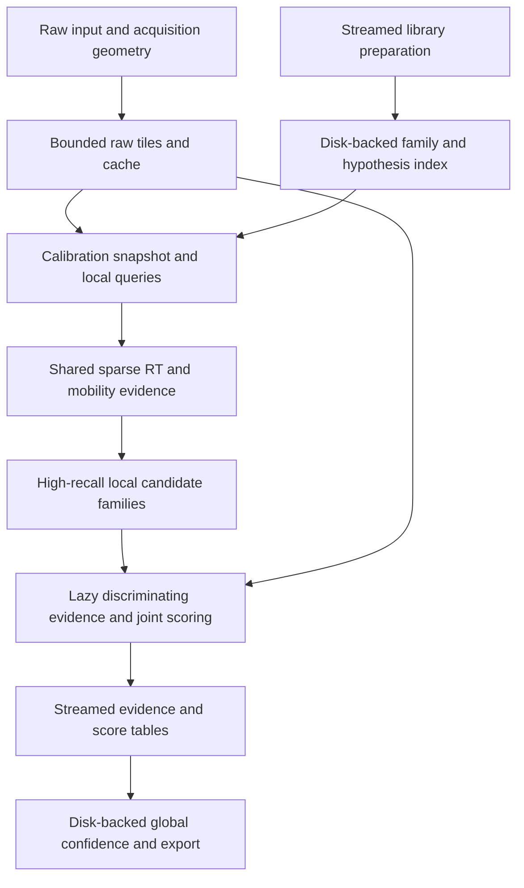

# Architecture: a bounded, mobility-native DIA search engine

[Plan and assignment index](README.md) | [Measured evidence](evidence.md)

**Status:** proposed, 20 October 2026. None of the new interfaces below has been implemented by this design exercise. Names describe responsibilities, not frozen C++ APIs.

## 1. Change the unit of work

Use two complementary units:

- **Execution unit:** a byte-budgeted acquisition-local raw tile, preserving exact RT, m/z, mobility and isolation geometry.
- **Inference unit:** a local candidate peptidoform family at an RT/mobility region, with shared fragment evidence and explicit alternative forms.

An assay must not own the entire extraction, picking, scoring and output lifetime. A raw tile must not define the scope of statistical confidence. Separate data locality from biological hypotheses.

These are in-process interfaces by default, not a requirement for an executable or intermediate file at every arrow. Optional checkpoints support reuse and debugging. A global resource coordinator covers every stage.

The search is hybrid: observed evidence identifies productive regions, while targeted recovery retains signals that a purely untargeted detector may miss. Do not require a full feature map before searching, a whole-run evidence graph, or full-library XIC materialization.

## 2. Resource contract

Proposed first acceptance platform: CPU-only laptop with 16 GiB RAM, tested at 2 and 4 worker threads, with a 4 GiB process-memory setting and a 2 GiB low-memory setting. These targets need implementation and measurement.

An illustrative allocation at 4 GiB is:

| Component | MiB |
|---|---:|
| Raw decoding and tile cache | 768 |
| Hypothesis-index pages | 512 |
| Shared evidence | 768 |
| Active candidates/scoring | 256 |
| Prediction/model workspace | 512 |
| Writer queues/encoders | 256 |
| Runtime/native libraries/safety reserve | 1,024 |
| **Total** | **4,096** |

These are starting estimates, not fixed partitions. Managed allocations must satisfy:

`raw + index + evidence + candidates + models + writer <= process target - runtime reserve`

Require reservations before allocation. Distinguish reservations from committed and resident memory. Grow pools with demand, expose minimum allocation granularity, and account for compressed/decompressed coexistence, native model scratch, memory-mapped residency, pending results and encoder buffers. Multiple workers share caches and the global budget.

The accounting invariant does not prove bounded RSS. Measure process and cgroup memory, including children and relevant native allocations. Respect container limits, not just host available memory. Oversized jobs must split, spill or fail explicitly. Never silently admit them, treat a zero budget as unlimited, or discard hypotheses to fit memory. Bound temporary disk usage and detect insufficient space.

Resource acquisition must not deadlock when a producer holds raw/evidence buffers while waiting for scoring or writer reservations. Define reservation ordering, cancellation and backpressure before increasing concurrency.

## 3. Data contracts

| Contract | Contents and ownership |
|---|---|
| `RawTile` / raw-region service | Packed numeric centroid arrays, frame/scan offsets, exact coordinate references, isolation geometry, validity and calibration identity; bounded owning buffers with leased views |
| `HypothesisStore` | Paged family/precursor directory, ragged fragment definitions, target/decoy identity, prediction provenance and cold sequence/protein metadata |
| `ExtractionQuery` | Full scientific query identity: run/lane, acquisition selection, RT/mz/IM bounds, units, tolerance/edge policy, aggregation, isotope and calibration versions |
| `EvidenceBlock` | Sparse RT-by-mobility support, ragged offsets, masks and exact axes; chromatograms/mobilograms are views, not mandatory duplicated objects |
| `CandidateFamily` | Stable family and candidate IDs, local region, competing forms, fragment incidence, null/alternative hypotheses and completeness state |
| `ScoreBatch` | Identification/localization/quantification evidence and results, provenance and raw references, independent of transient tile lifetimes |

Preparation is part of the engine: digestion, prediction, decoy creation, normalization and index construction must not rebuild the whole library in memory. Expensive detailed predictions may be deferred only when retrieval does not already require them. Include index preparation in cold-run timing.

## 4. Mobility is native evidence

Keep acquisition geometry by frame/scan, not a presumed static rectangular isolation window. Keep MS1 and MS2 acquisition axes distinct. Treat FAIMS compensation voltages as discrete strata, not a continuous mobility coordinate. Missing acquisition differs from measured zero. Non-IM data uses the same contract with an absent mobility axis.

Preserve sparse local RT/mobility patches and multiple supported mobility components. Coarse bins are lookup accelerators, not an irreversible replacement for measurement coordinates. Use mobility during:

1. Retrieval with calibrated uncertainty and a broad recovery path when calibration is weak.
2. Scoring of precursor/fragment consistency, shapes, predicted mobility and interference.
3. Quantification over explicit RT/mobility boundaries, retaining ambiguity when components cannot be separated.

## 5. Peptidoform families are the inference unit

Start from a backbone and modification composition with alternative sites, partitioned by relevant charge/adduct and precursor constraints. Define later evidence combination across charge states explicitly. Unrelated sequences may still compete for shared or interfering evidence.

For each local family:

1. Retrieve compatible hypotheses without requiring detectable MS1 or a strong common anchor.
2. Extract identical shared queries once and reference their evidence from all compatible hypotheses.
3. Generate/query site-discriminating fragments and informative loss channels lazily.
4. Accumulate sparse fragment-to-hypothesis incidence and sufficient statistics, not a dense forms-by-fragments-by-RT-by-mobility tensor.
5. Score identity, localization and interference without deleting weak but distinguishing evidence prematurely.
6. Retain unresolved groups or supported coexisting forms instead of forcing a single localized winner.

Avoid precomputed pairwise UIS combinations. Large families may still be intrinsically expensive. Any beam, top-k, approximation or branch pruning changes inference and needs explicit provenance and truth-based calibration. A finite memory target is not a promise of bounded execution time for arbitrary modification spaces.

## 6. Extraction, boundaries and numerical semantics

Adopt locality-oriented extraction ideas from the referenced `okohlbacher/dia-trace-extract-prototype`, but benchmark a pinned revision. It is an extraction component, not evidence of end-to-end identification equivalence.

Share evidence only for identical complete queries. Similar m/z values alone are insufficient. Batch active interval queries over resident sorted centroids. Retain raw-region access for scores needing apex spectra, dynamic merged spectra, isotopes or precursor evidence.

Define tolerance units, edge inclusion, sum/max aggregation, coordinate precision and missingness before optimization. Existing extraction has a diagnosed first-centroid discrepancy on a nonzero fixture, so agreement with legacy output is not the sole correctness oracle. Keep normative numerical tests distinct from compatibility comparisons.

RT halos alone do not establish unchanged candidate selection. The current picker uses whole-input XIC totals, intensity-ratio stopping, consumed peaks and overlap suppression. If retained as a reference mode, preserve its complete assay domain or equivalent state. For the new algorithm, explicitly define completeness domains, boundary reconciliation and global per-assay reporting limits. Deterministic apex ownership removes duplicates but cannot repair truncated evidence.

Freeze calibration during a processing pass and invalidate dependent query/candidate caches when it changes. Retrieval must use interval overlap, not only predicted-RT centers.

## 7. Confidence and durable output

Keep identification, localization and protein inference confidence distinct. Do not count shared fragment observations multiple times as independent evidence. Preserve alternatives and nulls through candidate filtering.

Apply equivalent target/decoy selection logic, then validate error calibration. Symmetry alone is insufficient. Never concatenate independently computed tile-level q-values. Stream compact tables into disk-backed global sorting, competition, model fitting and reduction. State when fitting is exact or sampled.

The canonical stored schema must support localization and rescoring independently of export backend. Preserve candidate/family/form IDs, discriminating and shared evidence, masks, acquisition/calibration identity and model provenance. Optional trace export must not make a whole-run feature map the normal path. Define crash-safe checkpoints and schema compatibility.

## 8. What should make it fast

These are hypotheses, not measured greenfield gains:

- Decode and query acquisition-local tiles rather than rescan entire windows for every assay batch.
- Eliminate impossible geometry/mass/RT/IM matches before detailed evidence generation.
- Share identical extraction and family evidence, with packed arrays and numeric IDs.
- Generate expensive predictions and discriminating fragments only when needed.
- Adapt concurrency to locality, decoder capacity, memory bandwidth and writer throughput.
- Allow a bounded number of sequential passes when this improves total runtime and memory.

Measure preparation, decoding, retrieval, extraction, scoring, confidence and writing separately, plus the total. Report cold first-use and warm index reuse, CPU/wall time, peak RSS/cgroup usage, disk I/O/temporary space, candidate counts and evidence volume.

## 9. Acceptance matrix and owners

| Requirement | Concrete acceptance observation | Primary packages |
|---|---|---|
| Laptop memory | Complete public workflow within agreed 2/4 GiB process limits, external memory measurement and no swapping | 02, 09, 10 |
| Speed | Cold/warm end-to-end comparisons at matched search space and quality, repeated on declared laptop/storage hardware | 00, 10 |
| Large predicted libraries | Scale absent hypotheses and localization alternatives on a fixed acquisition, reporting preparation and search costs separately | 04, 06, 10 |
| Native mobility | Real overlapping IM components, PASEF geometry, uncertain calibration, missing scans, discrete FAIMS and non-IM inputs | 03, 05, 06, 09 |
| Localization | Known-site mixtures and unresolved/coexisting cases, localization error separate from sequence confidence and quantitative error | 07, 08, 10 |
| Safe retrieval | Pre-FDR recall and entrapment/held-out calibration across abundance, modification type and ambiguity | 00, 06, 08 |
| Stable execution | Equivalent candidate IDs/sets and tolerance-bounded scores/quantities across tiles and workers, with complete boundaries | 01, 05, 06, 09 |
| Overload safety | Dense windows, huge families, slow writers, low disk, cancellation and undersized budgets have explicit bounded outcomes | 02, 04, 08, 09 |
| Output usability | Localization-capable stored evidence, exported results and supported installed consumers preserve advertised capabilities | 08, 09, 10 |

Agree numerical/quality margins and the quantitative speed gate before evaluating the new engine. The first public vertical slice must include mobility and peptidoform competition together. Passing separate legacy tests is not that slice.
