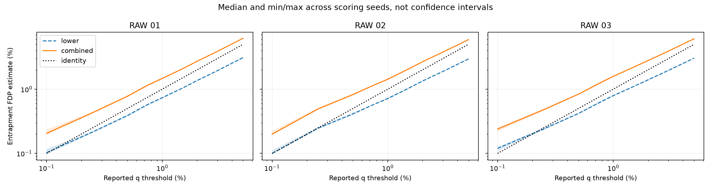

# RESULT_ASTRAL_FULL, 24 November 2026

Full predicted-library Astral capacity benchmark under [PLAN_ASTRAL_FULL](PLAN_ASTRAL_FULL.md), with the
pre-execution amendments [SCHEDULER_AMENDMENT](SCHEDULER_AMENDMENT.md), [CUDA_RETRY](CUDA_RETRY.md) and
[LABEL_AMENDMENT](LABEL_AMENDMENT.md). Descriptive only. There is no pass/fail threshold, no claim of FDR control and
no claim of quantitative accuracy. Artifacts are in [results/](results/).

## Outcome in one paragraph

All 15 searches (3 raws x 5 seeds) on the unsampled 8.59M-target / 8.57M-decoy library completed with exit 0. None
was retried, replaced or selected. At reported q <= 1% they accept 82.7k-86.2k target precursors per run (raw medians
85.2k / 86.0k / 83.2k). Each search took 1.1-2.0 h on 16 cores and 86-89 GiB peak memory, so the 32 GiB laptop
budget is far exceeded at this library size. The entrapment estimates exceed the reported q at every threshold. At
q = 1% the combined estimate is 1.32-1.55% with exact marker labels (1.39-1.63% from the frozen evaluator, which
mislabels; see below), and the lower estimate is 0.66-0.77%. The earlier conclusion that q calibration is not
established stands, and is not resolved here.

## Attempts, failures included

| Attempt | Jobs | Outcome |
|---|---|---|
| 1 | 41517072-75 | GPU prediction FAILED exit 13 after 15 s (bundled CUDA 12.6 lacks `cudaLibraryGetKernel`); the rest were dependency-cancelled or failed. Fixed by the pinned CUDA 12.8 runtime ([CUDA_RETRY](CUDA_RETRY.md)) |
| 2 | 41518555-58 | Prediction COMPLETED; decoys COMPLETED inside preparation, then view construction FAILED on the label rule (518 target/decoy sequence collisions); searches cancelled; evaluation failed. Fixed by [LABEL_AMENDMENT](LABEL_AMENDMENT.md), pushed before any search |
| 3 | 41607467, 41607472, 41607474 | Views COMPLETED, 15/15 searches COMPLETED exit 0, evaluation COMPLETED |

Two scheduler submissions were rejected before any job ran ([SCHEDULER_AMENDMENT](SCHEDULER_AMENDMENT.md)). Accounting:
[attempt1](results/attempt1_accounting.tsv), [attempt2](results/attempt2_accounting.tsv),
[attempt3](results/slurm_accounting.tsv).

## Library

| | |
|---|---|
| Digest | 2,841,736 FASTA peptides -> 2,692,562 peptides, 8,649,692 precursors, 164.9M eligible fragments |
| Targets after fragment selection | 8,588,443 (6-20 fragments) |
| Predicted pseudo-reverse decoys | 8,573,370 (1-20 fragments); 15,073 targets without own decoy, 2,491,338 pairs with fewer decoy fragments, 527 sibling-count imbalances, 518 peptides shared by a target and a decoy (859 / 520 precursors) |
| Entrapment structure | 4,294,504 entrapment vs 4,293,939 non-entrapment targets, r = 1.000132 (exact `_p_target`, `DECOY_` proteins ignored) |
| Files | targets20 15.5 GB, predicted20 27.7 GB, search6 27.7 GB, scoring12 28.4 GB (top-k views are pruned copies, not vacuumed) |

Structure and hashes: [structure.json](results/structure.json).

## Identifications (frozen evaluator, `eval_full.py`)

Target precursors accepted at reported run q. Median [min-max] over 5 seeds. Seeds on the same raw are not
independent replicates.

| q | raw01 | raw02 | raw03 |
|---|---|---|---|
| 0.1% | 65,224 [64,342-66,334] | 66,064 [65,206-66,423] | 64,235 [63,222-64,600] |
| 0.5% | 78,849 [78,350-79,147] | 80,657 [80,312-80,820] | 76,955 [76,901-77,324] |
| 1% | 85,173 [84,569-85,488] | 86,030 [85,934-86,172] | 83,182 [82,660-83,296] |
| 2% | 91,603 [91,175-92,111] | 92,293 [92,211-92,379] | 88,992 [88,726-89,356] |
| 5% | 102,329 [101,881-102,556] | 102,502 [102,308-102,533] | 99,272 [98,997-99,646] |

Unique human modified peptides at 1%: 66,073-66,942 (raw01), 66,765-67,072 (raw02), 63,697-64,265 (raw03). Full grid:
[calibration_per_run.tsv](results/calibration_per_run.tsv), [calibration_curve.tsv](results/calibration_curve.tsv).

## Entrapment estimates, and an evaluator labelling error

**Error in the frozen `eval_full.py`.** It labels entrapment with SQL `LIKE '%_p_target%'`. In `LIKE`, `_` matches any
character and matching ignores case, so human accessions with `P` or `p` before `_target`, such as
`sp|AACHPAPLPPMP_target|...` or `sp|AALGPLGP_target|...`, also count. 3,527 human
library targets are mislabelled, which gives r = 1.00178 instead of 1.00013 and inflates E. The plan, `prepare_library.py`
and `eval_quant.py` all use the literal marker (`instr`). The frozen outputs are kept unchanged. The table below adds
a read-only recount with the literal marker on the same search outputs
([label_like_vs_instr.txt](results/label_like_vs_instr.txt)). Nothing was rerun or reselected.

Range over the 15 runs (combined = E(1+1/r)/N, lower = E/N):

| q | combined, frozen (`LIKE`) | combined, literal marker | lower, literal marker |
|---|---|---|---|
| 0.1% | 0.19-0.25% | 0.14-0.19% | 0.07-0.09% |
| 0.5% | 0.74-0.84% | 0.68-0.78% | 0.34-0.39% |
| 1% | 1.39-1.63% | 1.32-1.55% | 0.66-0.77% |
| 2% | 2.64-2.84% | 2.56-2.75% | 1.28-1.38% |
| 5% | 5.88-6.28% | 5.78-6.20% | 2.89-3.10% |

With either labelling, the combined estimate is above the reported q from 0.1% to 5% on every run, by about 1.3-1.6x at 1%. Raw03 is
consistently highest. These are descriptive estimates that depend on the assumptions in the plan. The combined
estimate is not a proven upper bound, and the lower one is not a proven lower bound. The paired estimator remains
blocked. This matches the earlier Astral calibration diagnostic: q is not shown to be calibrated, and nothing here
was used to tune scoring.

## Quantification (frozen `eval_quant.py`, three raws per seed)

Labels in the human population use the literal marker and are not affected by the error above. Ranges over the 5
seeds. CVs are medians over features complete in all three raws. The 3 raws are the same 50 ng human material by
file name only; technical-replicate provenance is not authenticated, so this is three-raw dispersion.

| q | population | precursor union | in all 3 raws | median CV raw / median-normalized | pairwise log2 r |
|---|---|---|---|---|---|
| 0.5% | all | 104,051-104,490 | 54.6-54.7% | 10.5% / 10.3-10.4% | 0.977-0.980 |
| 1% | all | 111,886-112,315 | 54.7-54.9% | 10.8-10.9% / 10.7% | 0.976-0.979 |
| 2% | all | 120,875-121,319 | 54.3-54.5% | 11.2-11.3% / 11.0-11.1% | 0.975-0.978 |
| 0.5% | human | 103,388-103,812 | 54.9-55.0% | 10.5% / 10.3-10.4% | 0.977-0.981 |
| 1% | human | 110,505-110,939 | 55.3-55.5% | 10.8-10.9% / 10.7% | 0.976-0.979 |
| 2% | human | 118,065-118,489 | 55.5-55.6% | 11.2-11.3% / 11.1% | 0.975-0.978 |

Peptide level (summed charge states) at 1%: union 79.4k-81.1k, 65.5-66.5% in all three, median CV 10.0-10.1%,
log2 r 0.951-0.959. Human-population exclusions per run: 268-311 (0.5%), 567-645 (1%), 1,165-1,243 (2%). Only about
55% of precursors are seen in all three raws, which reflects per-run identification without cross-run transfer. This
measures repeatability, not accuracy, fold-change recovery or protein-level quantification. Summary:
[quant_summary.json](results/quant_summary.json) (made by [summarize_quant.py](results/summarize_quant.py) from the
frozen JSONs, which are 0.8 GB each and stay on Codon).

## Resources

| Step | Job | Wall | Peak memory | Notes |
|---|---|---|---|---|
| GPU prediction | 41518555 | 38:02 | 108.6 GiB | 1x A100, 16 CPU; RT/MS2 on CUDA. Inference about 2 min, single-threaded PQP write about 36 min |
| CPU decoys (OpenSwathDecoyGenerator, inside attempt-2 preparation) | 41518556 | 45:44 of 53:33 | 157.5 GiB | 16 threads; job FAILED after the decoys finished (view step) |
| Top-6/top-12 views | 41607467 | 3:16:05 | 51.9 GiB (Slurm), 3.8 GiB (`time`) | Python/SQLite backup+prune; output files not vacuumed |
| 15 searches | 41607472 | 1:07-1:59 (median 1:35) | 85.7-88.6 GiB (`time`), 86.2-94.4 GiB (Slurm) | 16 CPU, 256 GiB, `%3` concurrency, AMD EPYC 9555 nodes, shared NFS; 23.9 h wall and 125.5 CPU-h in total |
| Evaluation | 41607474 | 07:17-07:52 (35 min) | | Quant JSONs dominate |

Queue delays were short (searches started within seconds of the dependency clearing). Search wall time varies
1.1-2.0 h on the same CPU model, which reflects node and filesystem load, not seed. Attempt-1 and failed attempt-2 jobs
are part of the cost: 15 s GPU, 53:33 preparation (whose decoy step is the decoy cost of record).

## Context: ProteoBench DIA-NN 2.3.1 on the same raws and library (not a matched comparison)

The supplied ProteoBench log (`proteobench_diann_v231_res_20260717_123332/param_0..txt`, same FASTA, 8,649,692
precursors, 16 threads, different hardware) reports per-run IDs at 1% FDR:

| | raw01 | raw02 | raw03 |
|---|---|---|---|
| DIA-NN first pass (per run, no reanalysis) | 81,701 | 82,781 | 81,529 |
| DIA-NN second pass (`--reanalyse`, MBR library) | 82,360 | 82,498 | 81,685 |
| OpenDIA median over seeds, reported q <= 1% | 85,173 | 86,030 | 83,182 |

OpenDIA's counts are 2-4% higher at equal nominal q. That is the same size as the gap between its entrapment estimate
and the reported q, so these counts do not show more true identifications. DIA-NN was not graded with the same
entrapment labels here, its decoys and FDR model differ, and the whole DIA-NN analysis (both passes, three raws) took
about 24 min against about 1.6 h per OpenDIA run. A comparison at equal entrapment estimate would need DIA-NN's
per-precursor q values (possibly in the ProteoBench `input_file.parquet`) and was not part of this plan.

## What this does not show

- That OpenDIA controls FDR on this library, or that it identifies more true precursors than DIA-NN.
- Quantitative accuracy, or protein-level results.
- Laptop feasibility: the full library needs about 88 GiB per search, almost 3x the 32 GiB target.

## Follow-ups (not started)

- Fix the `LIKE` marker match in `eval_full.py` for future plans (literal `instr`, as in the other scripts).
- Memory: the library dominates at this scale. The Parquet library (322caaceca, not used here; the container predates it)
  reduces load cost, but per-run copies and the in-memory layout are the next targets.
- The pruned PQP views should be vacuumed or replaced by Parquet. The single-threaded PQP write was most of the GPU
  job's time.
