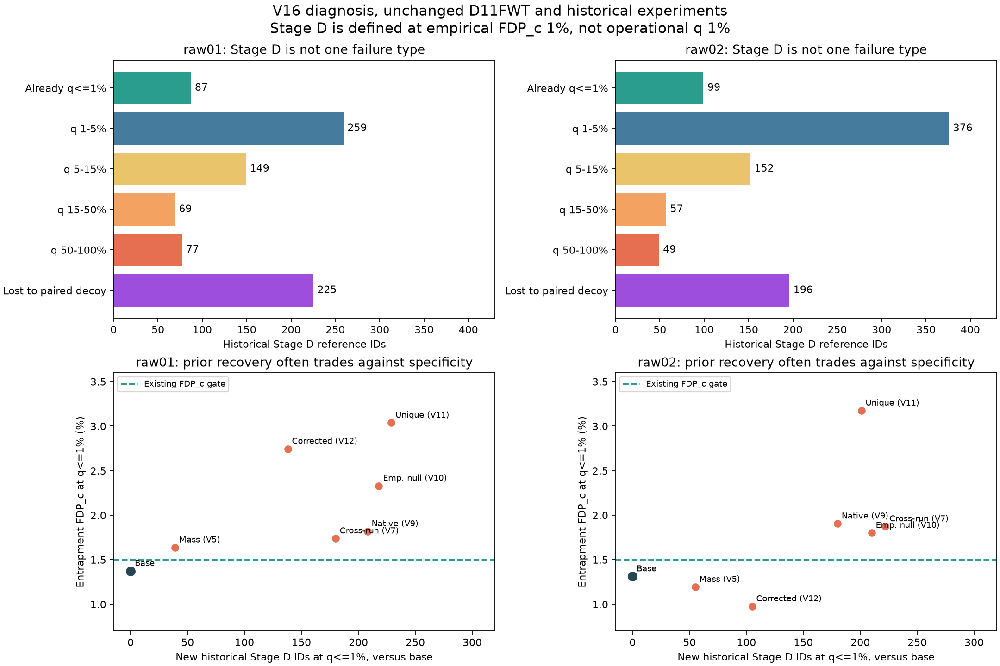

# V16: why Stage D is missed, and what to test next

Date: 12 November 2026. Diagnostic only, unchanged old-population D11FWT on raws 01/02. No new recovery model, changed threshold, C++ promotion, or recovered-ID claim.

## Executive finding

Stage D is not one failure mode. Many IDs are close to the operational cutoff, a substantial subgroup is driven deep into the decoy distribution, and a smaller subgroup has appreciable apex disagreement relative to its narrow peak. Earlier interventions really did recover some historical D IDs, but often admitted more entrapments or displaced accepted IDs. Therefore another indiscriminate evidence bonus, looser threshold, or weaker nonlinear penalty is not justified.

The strongest new finding is a train/deploy mismatch in window selection. Self-training picks each precursor's window by the full score, but deployment (W) picks it by the linear part. For the deeply suppressed D IDs (below the decoy 90th percentile, 287/230), the D window was never a training positive in 268/287 and 222/230 cases. In 251/287 and 212/230, the full model prefers a different window more than 10 s away. So the model was never trained on the window it is later asked to score. That association motivates one proposed experiment (section 6). It is not yet a demonstrated recovery.

## 1. First correct the definition of a miss

The historical D label means a DIA-NN-reference precursor, with our selected apex within 10 seconds, below the **empirical entrapment FDP_c 1% cutoff**. It does not mean failure of operational target-decoy q<=1%. DIA-NN agreement is a reference annotation, not ground truth.

| Historical D subgroup | raw01 | raw02 |
|---|---:|---:|
| Already operational q<=1% | 87 | 99 |
| q in (1%, 5%] | 259 | 376 |
| q in (5%, 15%] | 149 | 152 |
| q in (15%, 50%] | 69 | 57 |
| q in (50%, 100%] | 77 | 49 |
| Lost to paired decoy | 225 | 196 |
| Total historical D | 866 | 929 |

Thus 779/830 historical D IDs are actual operational q1% misses. The 259/376 near-cut IDs and the deeply suppressed subgroup should not be treated as the same problem. Paired-decoy losses are not accepted decoy IDs.

At baseline q<=1%, target counts are 1614/1536, including 11/10 entrapments, with 15/14 paired decoy winners above the cutoff. These are decoy-count estimates, not counts of known false human IDs.

**Evaluator semantics retained:** historical N@FDP_c uses all precursor target winners. Operational q uses paired target-decoy competition, decoy priority on equal scores, and (D+1)/T. We retain both definitions exactly rather than silently changing the comparison pool. FDP_c = N_entrap * (1 + 1/r) / N_target, r=148983/151239.

Lowering the unchanged score cutoff to include 25% of historical D gives FDP_c 3.13%/1.90%. Including 50% gives 12.84%/7.19%. Simple threshold relaxation is not the solution.

## 2. There is measured signal, but much less coherent support

| Measurement | D raw01 / raw02 | Accepted reference E raw01 / raw02 |
|---|---:|---:|
| Median DIA-NN FWHM, seconds | 3.230 / 3.290 | 3.517 / 3.486 |
| Apex discrepancy > half FWHM | 21.02% / 16.90% | 2.34% / 1.76% |
| Apex discrepancy > one FWHM | 9.35% / 7.86% | 0% / 0% |
| Outside DIA-NN peak boundaries | 7.04% / 4.52% | 0% / 0% |
| Median F12 coherent-fragment support | 2 / 2 | 6 / 6 |
| Median conditional fragment dropout | 52% / 50% | 36.1% / 33.3% |

D has a median six fragments with some core signal, but only two pass the existing coherent-support definition. Presence is not the same as a reliable chromatographic profile. Raw01's median native revisit is 1.64635 seconds, so a median D FWHM spans only about two native revisits. No raw02 cadence was inferred without its scan metadata.

The prior median RT difference of zero did **not** establish that every D apex was correct: a 10-second right-window allowance spans about three D peak widths. Conversely, 79-83% of D lies within half a reference FWHM, so apex disagreement cannot explain the majority.

Changing the origin of an intensity-preserving time-bin aggregation changes Pearson coherence by >0.1 for 47.9%/51.7% of D. However, accepted E is even more sensitive, at 60.2%/63.7%. This demonstrates representation sensitivity, not a D-specific cause. Removing empty bins lowers D/decoy separation and cannot be assumed beneficial. An empty bin may be an acquired scan with no matching fragment, not an unacquired scan.

## 3. The nonlinear score has a necessary but costly role

Compare contributions at the **same baseline W-selected window**, with decoy distributions kept within fold:

| Comparison, AUC | Linear raw01 / raw02 | Full model raw01 / raw02 |
|---|---:|---:|
| D versus all decoy winners | 0.947 / 0.955 | 0.736 / 0.791 |
| D versus top 1% of full-score decoy winners | 0.498 / 0.557 | 0.536 / 0.633 |
| E versus that hard decoy tail | 0.973 / 0.980 | 0.998 / 0.999 |
| All human-library winners versus decoys | 0.560 / 0.557 | 0.513 / 0.517 |
| Entrapment winners versus decoys | 0.541 / 0.540 | 0.491 / 0.496 |

234/204 D IDs lie below the full-score decoy median. Their median linear percentiles are 94.83%/94.89%, while their median nonlinear-contribution percentiles are only 4.22%/4.44%. The nonlinear component clearly suppresses this subgroup.

But the same component improves separation from the hard decoy tail and removes much of the entrapment/decoy asymmetry present in the linear part. It also moves more D IDs upward across the decoy 99th percentile than downward. This is not evidence that removing it would work. The previous linear-only ranking was already worse overall.

The current D11F model is a **17-summary-input MLP with a linear skip**, not a raw voxel encoder. It cannot infer an interference pattern absent from those summaries. V12 did add a raw/corrected voxel view and failed, so simply requesting a more expressive encoder is not a new evidence-backed fix.

## 4. Training exposure and window selection

Exact reconstruction came first: both raws reproduce original full and linear scores with maximum absolute error 0 and identical W-selected rows. All input hashes are unchanged. A four-thread attempt failed the gate and was excluded from attribution. Restoring the original ten Torch threads reproduced the baseline exactly. Memberships were saved label-blind and joined to labels only after both gates passed.

Exact W row, any positive role (training or validation), across the two models for which each family is eligible:

| Category | D raw01 | D raw02 | E raw01 | E raw02 |
|---|---:|---:|---:|---:|
| Never admitted as positive | 397 | 371 | 0 | 0 |
| Admitted, then lost by round 2 | 60 | 51 | 0 | 0 |
| Retained in round 2 | 409 | 507 | 1413 | 1362 |

Precursor-level counts differ by at most 5. Retained D almost all score above the decoy 99th percentile (405/409, 506/507). The losses sit in never-admitted D: median held-out full percentile 0.33/0.39 against linear percentile 0.95/0.95. Training-positive-only counts (462/450 never admitted) are higher only because validation-hash members are excluded, not because those rows were absent.

Window mismatch, same model, full-score versus linear selector, round 2:

- Admitted D positives almost never differ by >10 s: 3/745 and 1/931. Wrong positive windows are not the problem.
- Eligible decoy precursors differ by >10 s in 143026/185994 (77%) and 147752/188770 (78%). The negatives and the q-based admission null used in training are therefore mostly not the windows deployed W would pick.
- Deep D: 251/287 and 212/230 are never admitted and have a final full-vs-linear selector disagreement >10 s.

All-human and entrapment winners are also mostly never admitted (about 95%), so non-admission alone is not D-specific. What is specific is the combination for deep D: high linear evidence at the W window, a competing full-score window elsewhere, and no training exposure. This is an association conditioned on DIA-NN-selected D, not a causal proof.

## 5. Why the previous ideas did not solve it

These are genuinely new historical D IDs passing q<=1% relative to baseline, **not net total sensitivity gains**:

| Arm | New D raw01 / raw02 | FDP_c at q1%, raw01 / raw02 | Previously accepted E lost, raw01 / raw02 |
|---|---:|---:|---:|
| Mass evidence V5 | 39 / 55 | 1.64% / 1.19% | 20 / 34 |
| Cross-run V7 | 180 / 222 | 1.74% / 1.87% | 64 / 77 |
| Native evidence V9 | 208 / 180 | 1.82% / 1.90% | 42 / 28 |
| Empirical null V10 | 218 / 210 | 2.33% / 1.80% | 87 / 67 |
| Unique fragments V11 | 229 / 201 | 3.04% / 3.17% | 118 / 99 |
| Corrected profiles V12 | 138 / 105 | 2.75% / 0.98% | 104 / 125 |

For example, V11 gains 22/24 entrapments and loses 7/8 baseline entrapments, ending with 26/26. V12's lower raw02 FDP does not rescue the experiment: it loses 125 accepted E IDs and fails the established overall gates. V13 deconvolution failed its diagnostic null guard before training. V14b only attenuated local-flank excess and recomputed largely amplitude-invariant F12 summaries, so its tiny score changes did not test realistic fragment dropout. V4 ranking loss and BCE alternatives have also already been tried.

DIA-NN-selected D has strong native-evidence separation at matched score, but that does not by itself identify a usable general target feature. With common D-weighted score strata, native apex evidence AUC is 0.874/0.851 for D, 0.583/0.582 for all human-library winners, and 0.514/0.524 for entrapments. Coverage is only 541/866 and 450/929 D, and no E strata meet the minimum counts. These are conditional diagnostics, not expected global recovery gains. All-human winners are a true/false mixture, so weaker all-human separation also does not prove absence of recoverable signal.

## 6. Proposed next experiment

One experiment, written up in [PROPOSED_PLAN_V17.md](PROPOSED_PLAN_V17.md) and not run: **selector-consistent self-training**. In rounds 1 and 2, pick each target and decoy precursor's window with the same linear W rule used at deployment, keep the full score for normalization, q, and admission, and change nothing else. It is a single variable, label-blind, symmetric for targets and decoys, and different from all prior arms (none changed training-window selection). The existing pass rule is unchanged: PLAN_V2 rules 1-4, N@2% above D11FWT on both raws, and the null-window AUC guard. Total entrapment and decoy gains and losses must be reported alongside D recovery and E losses.

Risk: the full-score selector also supplies hard decoy negatives. Aligning it may cost specificity, and the gates exist to catch that. If it fails on either raw, keep D11FWT and stop this arm. The alternative, kept separate, is training coverage under realistic fragment dropout and sparse sampling, with all 17 features recomputed.

## 7. Limitations and corrections to earlier interpretations

- Repeated analyses have used both raws. Raw02 is descriptive replication, not an untouched holdout.
- Neither DIA-NN agreement nor membership in the human library is ground truth. Entrapment annotations are evaluation-only.
- Conditioning on D or matching on current score can create apparent feature advantages. Coverage, ties, missingness, and controls are reported explicitly.
- V15's discrete matched-feature fractions were P(D>decoy), not tie-corrected AUC. Values below 0.5 with many ties do not establish reversed discrimination. V16 uses half credit for ties.
- Native and binned coherence use different boundaries in some comparisons. Only the explicitly intensity-preserving grouping-origin control isolates that particular change.
- A nonlinear contribution is not a causal biological explanation. A training-selection association also requires an intervention before it can establish recoverability.
- No entrapment-informed feature, positive selection, loss, threshold, or rescue rule was trained.

## 8. Reproducibility and validation

Benchmark root: `/home/singjc/Documents/github/OpenMS-r1-benchmark-20261107/astral-voxel-pilot-20261110/v2/v4/stageD_v16/`.

- Frozen PLAN_V16 and per-script pre-run hashes/timestamps.
- Six threshold-audit tests, including equivalence to the original evaluator, tie behavior, FDP edge cases, and degenerate normalization rejection.
- Evidence helper tests, all row-identity checks, existing support/core-fraction reproduction exactly, correlations to 1.3e-15, and mass conservation for every winner in the phase control.
- Score helper tests, independent pair-inversion checks, reconstruction gates, and selection-mismatch tests.
- Original reference input hashes retained and checked. No original score arrays or training source overwritten.
- Large row-level tables and checkpoints remain in the benchmark directory. Only scripts, aggregate outputs, provenance, logs, and figures are versioned here.
